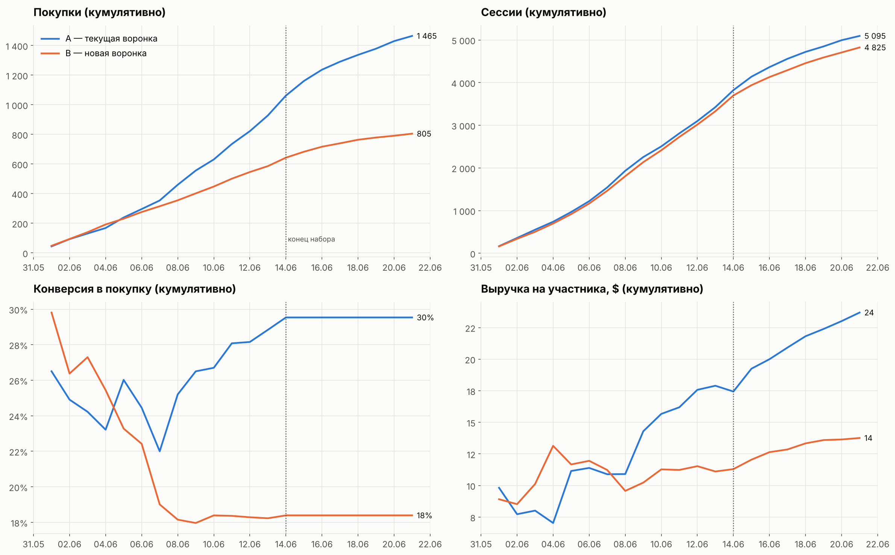
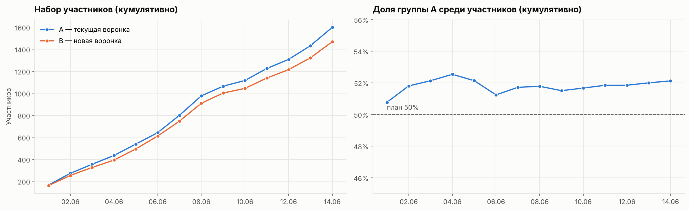
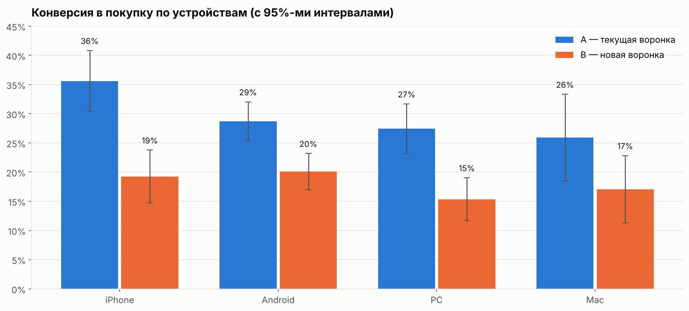

# A/B-тест новой платёжной воронки


Анализ A/B-теста `new_payment_funnel_test_summer_2025` интернет-магазина, работающего в Азии.
Гипотеза заказчика: новая платёжная воронка повысит конверсию в покупку. Нужно проверить корректность теста,
оценить эффект и дать рекомендацию о внедрении.

**[→ Открыть ноутбук с полным исследованием](notebooks/ab_test_analysis.ipynb)**

## Главное

| | |
|---|---|
| **29,5% → 18,4%** | конверсия в покупку: новая воронка снизила её на 11 п.п. (−38%), p < 0.001 |
| **−42%** | выручка на участника теста; средний чек покупателя при этом не изменился |
| **p ≈ 0.02** | группы разного размера (1 598 и 1 468): Sample Ratio Mismatch при плановом делении 50/50 |
| **6 июня** | до этой даты группы шли наравне; весь разрыв в конверсии возник после неё |



## Ответы на вопросы заказчика

**Был ли тест проведён согласно заданию?** В основном да. Набор участников шёл 1–14 июня, наблюдение до 21 июня,
пересечений между группами и с параллельным тестом `new_login_screen_apac` нет. Отклонение: тест фактически нацелен
на Юго-Восточную Азию (96% участников), но в него попало около 100 пользователей из других регионов.

**Было ли распределение на группы корректным?** Не полностью. В группе A на 130 человек больше, и такой перекос
при делении 50/50 случайно возникает лишь в 2% случаев. Доля A превышала 50% весь период набора. По устройствам
и регионам группы сбалансированы.



**Есть ли различие в целевой метрике?** Да, и в обратную сторону от гипотезы: новая воронка **снижает** конверсию.

| Метрика | A — текущая | B — новая | Разница | Тест |
|---|---|---|---|---|
| Конверсия в покупку | 29,5% | 18,4% | −11,1 п.п. (95% ДИ −14,1 … −8,2) | z-тест для долей, p < 0.001 |
| Выручка на участника | 23,7 $ | 13,8 $ | −9,9 $ (бутстреп-ДИ −15,1 … −5,0) | Манн — Уитни, p < 0.001 |
| Выручка на покупателя | 80,2 $ | 74,8 $ | незначимо | Манн — Уитни, p = 0.35 |

## Главная находка: перелом в середине теста

| Зарегистрировались | Конверсия A | Конверсия B | p-value |
|---|---|---|---|
| 1–5 июня | 26,0% | 23,3% | 0.31 — разницы нет |
| 6–14 июня | 31,3% | 15,9% | < 0.001 |

Первые пять дней группы шли наравне, а с 6 июня конверсия B упала сразу на всех устройствах. Сессии в группе B
длиннее весь тест (медиана 3,5 против 2 минут), а после 6 июня разрыв ещё вырос: пользователи дольше остаются
в воронке и чаще бросают оплату. Скорее всего, около 6 июня в новой воронке что-то сломалось: релиз,
смена платёжного провайдера или новый шаг оплаты. Тогда проблема может быть не в идее новой воронки,
а в сбое во время теста.



## Рекомендации

1. **Не внедрять новую воронку в текущем виде:** при раскатке магазин потерял бы около трети новых покупателей.
2. **Сверить события около 6 июня с журналом релизов.** Если причина техническая — исправить и перезапустить тест.
3. **Добавить пошаговую аналитику оплаты**, чтобы видеть, на каком шаге уходят пользователи. В текущих данных шагов воронки нет.
4. **Проверить сплиттер трафика** до следующего теста: SRM ставит под сомнение и будущие эксперименты.
5. **Явно задавать и проверять аудиторию теста** на старте, чтобы в тест не попадали пользователи других регионов.

## Методология

- Данные выходят за рамки теста (регистрации до 30 июня, события до 14 июля). Учитываются только участники теста,
  их события после регистрации и до конца 21 июня — иначе выручка завышается покупками после окончания теста.
- **SRM** — хи-квадрат тест на соответствие размеров групп плану 50/50; баланс по устройствам и регионам — хи-квадрат.
- **Конверсия** — двусторонний z-тест для двух пропорций с доверительным интервалом разности. Двусторонний,
  потому что новая воронка могла и ухудшить метрику.
- **Выручка** сильно скошена (покупки от 4,99 до 499,99 $), поэтому для неё — критерий Манна — Уитни
  и бутстреп-интервал вместо t-теста.
- **Проверка устойчивости к SRM:** даже если бы все «недостающие» до 50/50 пользователи B были покупателями,
  конверсия B осталась бы значимо ниже.

### Чем подход отличается от типового решения

| Типовое решение | Здесь |
|---|---|
| Группы 1 598 и 1 468 названы «примерно одинаковыми» | SRM-тест: перекос значим (p ≈ 0.02), проверена устойчивость вывода к нему |
| Учитываются все покупки, включая сделанные после окончания теста | события ограничены периодом теста |
| Кумулятивно строятся число пользователей и сессий | кумулятивные конверсия и выручка на участника + относительная разница B к A |
| Вывод: «новая воронка хуже» | эффект появился только с 6 июня — признак сбоя, а не обязательно плохой идеи |
| Только конверсия | выручка на участника и на покупателя, разбивка по устройствам, длительность сессий |

## Данные

| Файл | Содержание |
|---|---|
| `new_users_test_2025.csv` | новые пользователи: дата регистрации, регион, устройство |
| `sessions_test_2025.csv` | сессии: начало и длительность в минутах |
| `purchases_test_2025.csv` | покупки: дата и время, сумма в долларах |
| `participants_test_2025.csv` | участники тестов: группа и название теста |

Файлы из материалов учебного проекта лежат в `data/raw/`.

## Структура

```
ab-payment-funnel-test/
├── notebooks/
│   └── ab_test_analysis.ipynb   # исследование с выводами
├── src/
│   └── abtest.py                # подготовка данных и статистические тесты
├── data/raw/                    # исходные CSV
├── reports/figures/             # графики
└── requirements.txt
```

## Запуск

```bash
git clone https://github.com/EfimovAN18/ab-payment-funnel-test.git
cd ab-payment-funnel-test
python -m venv .venv && source .venv/bin/activate   # Windows: .venv\Scripts\activate
pip install -r requirements.txt
jupyter notebook notebooks/ab_test_analysis.ipynb
```

## Стек

Python · pandas · NumPy · SciPy · Matplotlib · Jupyter · A/B-тестирование

---

Автор: **Алексей Ефимов** — [github.com/EfimovAN18](https://github.com/EfimovAN18)
